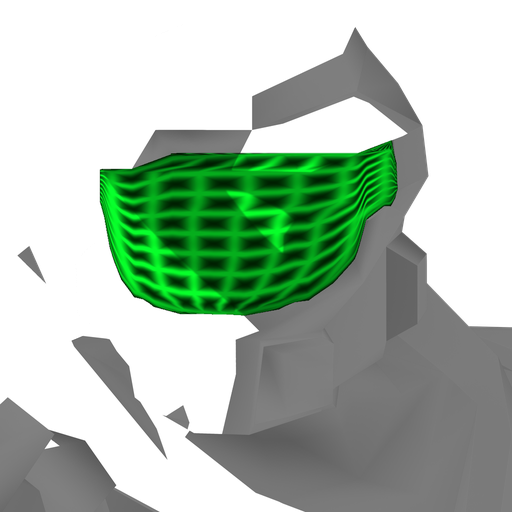

# MeshCE: Halo: Combat Evolved for Mac, Windows, and Linux

<table align="center">
  <tr>
    <td align="center" valign="middle">
      
    </td>
    <td align="left" valign="middle">
        
      
    </td>
  </tr>
</table>

  
  
  

  

**MeshCE** is Halo: Combat Evolved for Mac, Windows, and Linux. It follows [OpenCE](https://github.com/OpenCommunityEdition/OpenCE), which continues the decompilation of Xbox development build 2342, from [bnunu/halo-1](https://github.com/bnunu/halo-1), itself a fork of [punpckhdq/halo](https://github.com/punpckhdq/halo). Mac, Windows, and Linux each run the game's own code, with a new layer in place of the Xbox hardware. Windows and Linux draw with OpenGL. The Mac build draws with Metal. Sound, input, and gamepads go through SDL3.

## Mesh matchmaking

Mesh matchmaking is how players find a game. On the multiplayer menu, Find Game searches Free for all, 2v2, and Ranked. The search runs on the players' own computers. A new install says hello to the built-in introducer, `bitmoda.ddns.net`, and to players that machine has already heard. Players on the same local network are found by broadcast, and a player met before is tried again at the saved address. The player with the best connection hosts. Rank and games played change for a match found this way. A custom game joined from an invite link leaves them unchanged. Mac, Windows, and Linux speak network version 43. See [docs/peer-mesh.md](docs/peer-mesh.md).

Closing the window, or choosing Quit in the game, hides MeshCE and leaves it running. It keeps introducing players on the mesh. Quit from the tray icon on Windows and Linux, or from the menu bar icon on Mac, to stop it.

The mesh and the game use these UDP ports. Allow them inbound and outbound in the firewall. On Mac, allow MeshCE when the system asks to find devices on the local network. That permission is the broadcast on 38952. On Windows, allow `halo.exe` when the firewall asks.

| Port | Use |
| --- | --- |
| 38950 | Game server |
| 38951 | Game client |
| 38952 | Mesh discovery. The local broadcast and `bitmoda.ddns.net` both use this port. |
| 38960 | Ranked |
| 38961 | Free for all |
| 38962 | 2v2 |

On a home router, forward those UDP ports to this machine, or leave UPnP on so the game can ask the router. UPnP is `network.allow_upnp` in `config.toml`. The default is on. Internet play also opens one UDP socket for the game tunnel. `network.tunnel_port` chooses it. `0` lets the system pick a port, and UPnP forwards that port. Set `network.tunnel_port` to a UDP port you have forwarded when the router gives each destination its own port. One copy of the game listens on 38952.

Players on one Wi-Fi find each other by the broadcast on 38952. A machine that can receive these ports can host for players whose network only sends packets out. A phone hotspot keeps inbound UDP closed at the carrier, so a forward on the phone stays on the phone. Players meet when they share a network, or when one of them can receive inbound UDP on these ports.

You can also play with up to 128 players, run campaign co-op online, and host a custom game that others join from an invite link. Field of view and smooth motion are optional. With Smooth Motion on, the game draws a frame for every refresh of the display. The simulation stays at 30 ticks a second, as on the Xbox. The maps are the original Xbox maps.

## Download

The Mac button downloads build 77 (`MeshCE-macos-arm64.dmg`). The Windows button downloads build 77 (`halo-windows-release.zip`). The Linux button downloads build 77 (`halo-linux-release.zip`). Each system is published on its own. Those three are on the [releases page](https://github.com/bitmoda/MeshCE/releases).

| System | Download this | Then |
| --- | --- | --- |
| Mac | The newest Mac disk image | Open it and drag **MeshCE.app** into Applications |
| Windows | The newest `halo-windows-release.zip` | Unzip it and run `halo.exe` |
| Linux | The newest `halo-linux-release.zip` | Unzip it and run `halo` |

### Mac

The Mac build is for Apple Silicon and macOS 26 or later. The disk image is enough to run the game.

1. Download the newest Mac disk image.
2. Open it and drag **MeshCE.app** into Applications.
3. Open MeshCE from Applications.
4. The app is ad hoc signed. The first time, macOS may leave it blocked. After you try to open it, allow it in **System Settings**, under **Privacy & Security**. [Apple's steps](https://support.apple.com/en-us/102445) walk through that screen.

On Mac, the helmet in the menu bar opens Settings, and the same menu chooses a disc image or a maps folder. Command-comma opens Settings. F12 releases the mouse so you can reach the menu bar. Escape pauses.

### Windows

1. Download the newest `halo-windows-release.zip`.
2. Unzip it into its own folder.
3. Run `halo.exe`. Leave `SDL3.dll` in that same folder.

Settings live in `config.toml` next to `halo.exe`. Saves go in `%APPDATA%\MeshCE Mesh`.

### Linux

1. Download the newest `halo-linux-release.zip`.
2. Unzip it into its own folder and run `halo`.
3. The zip brings its own SDL3 (`libSDL3.so.0`). Install the 32-bit OpenGL libraries, the 32-bit PipeWire or PulseAudio client, and the 32-bit X11 libraries. SteamOS already has them. Package names, glibc, and Wayland are in the [Linux README](port/linux/README.md), along with controls and settings. Most of the controls and settings are the same on every platform.

On a Steam Deck, do the setup in Desktop Mode. Unzip the release, then in Steam open the Games menu, choose Add a Game, and add `halo` as a non-Steam game. It then starts from Game Mode as well. If the Deck sleeps while it is hosting, the other players lose the host after 15 seconds.

Settings live in `config.toml` next to `halo`. Saves go in `~/.local/share/meshce-mesh`, or in `$XDG_DATA_HOME/meshce-mesh` when that variable is set.

### Updates

On Mac, a copy from build 76 onward checks this releases page for a newer disk image and asks before installing it. A Mac on build 75 stays where it is until you download the disk image above.

On Windows and Linux, download a newer zip from the same page and replace the program files. Leave maps, saves, and `config.toml` where they are. If the game offers an update, **Yes** replaces the program files and keeps the previous copies with a `.old` name until the next start. **No** asks again next time. **Do not ask again** writes that choice into `config.toml`. A build you compile yourself has no build number and does not ask.

## OpenCE for Mac

OpenCE on Apple Silicon is a separate release. It keeps the OpenCE menus and gameplay. Its network protocol is 44. MeshCE's updater does not install it, and the OpenCE updater does not install MeshCE.

  

The button downloads `opence-macos-arm64.dmg` from `opence-build-1`. Open the disk image and drag **OpenCE.app** into Applications. It is for Apple Silicon and macOS 26 or later. The app is ad hoc signed. If macOS blocks the first open, allow it in **System Settings**, under **Privacy & Security**. Saves go in `~/Library/Application Support/OpenCE`.

## Your own copy

Bring your own copy of the game. The download has no game data.

1. Start the game (`MeshCE.app` on Mac, `halo.exe` on Windows, `halo` on Linux).
2. The first time, choose your copy. On Mac the question offers **Choose Disc Image…** or **Choose Maps Folder…**. A disc image is read into `~/Library/Application Support/MeshCE Mesh/Game Data/`. A maps folder offers **Copy and Manage**, **Use This Folder**, or **Cancel**. Managed copies go in that same Game Data folder. Saves, profiles, and `config.toml` stay in `~/Library/Application Support/MeshCE Mesh`.
3. On Windows and Linux, that first start asks to extract the maps from an Xbox disc image. **Yes** opens a file picker, and the maps are copied next to the program. A `maps` folder already sitting there is used and that question stays closed. **No** stops the game. You can also put a `maps` folder next to the program, or set `paths.data` in `config.toml`, and start again.
4. The game uses those Xbox maps, then starts.

On Mac, saves and caches stay in `~/Library/Application Support/MeshCE Mesh/`. Files already in that folder stay. `Halo OG`, `Halo CE Universal`, and an installed OpenCE folder stay where they are.

Put the Xbox maps in `maps`. If `maps` contains Halo PC maps, the game explains that and stops.

On Windows and Linux, `maps` sits next to the executable, whether that first start extracted it or you placed it there. You can also set `paths.data` in `config.toml` to a folder you already have. On Mac, the first launch offers a disc image or a maps folder. A managed copy goes in `~/Library/Application Support/MeshCE Mesh`.

## Multiplayer

- **Up to 128 players** on up to 128 machines, and up to 4 players on one device in split screen.
- **Mac, Windows, and Linux play together.** On a local network they can play LAN. A LAN game does not need an invite.
- **Peer-to-peer internet hosting.** The host's invite link names that host's address and public key. Opening the link connects to the host. With Discord running, the host can send the same invite through Discord.
- **Find Game.** Free for all, 2v2, and Ranked use the mesh at the top of this page, on the UDP ports listed there. Rank and games played change for a match found this way. A custom game joined from an invite link leaves them unchanged.
- **Online co-op campaign,** with friendly fire, player collisions, and more enemies as the player count grows.
- **Voice chat:** push to talk (V) or an open microphone, changed in the audio settings.
- **Moderation:** the host can kick and ban from the scoreboard, or with the `kick` and `ban` console commands. Players can vote to kick.
- **Scrollable scoreboard:** the mouse wheel or Page Up and Page Down moves through a large lobby.
- **Netcode:** each machine moves its own player at once, and the host decides the game. See [port/linux/NETCODE.md](port/linux/NETCODE.md).

## Competitive options

**MeshCE Options** offers spawn markers, timer announcements, and optional silent movement and weapon-ready sounds. Those modifications default off. The host chooses them. Use **Stock** for original-rule play. The match clock is each machine's Graphics setting: Off, On, or On with Voice. On with Voice plays the countdown shipped with the game.

**Match Options**, on the game type, covers movement sounds, training, camouflage, team scores, weapon spread, and field of view. The host's choices apply to the game. Default field of view leaves each player's Graphics setting.

## Graphics

The game keeps the Xbox look until a setting says otherwise.

**Display**

| Option | What it does | Default |
| --- | --- | --- |
| DISPLAY MODE, RESOLUTION, WINDOW SIZE | Fullscreen, borderless, or windowed. F11 switches mode. | Borderless, at the display's resolution |
| RESOLUTION SCALING | Draw at the window's resolution, or at the Xbox's 640x480 and scale it up | Native |
| V-SYNC, FRAME RATE LIMIT | Wait for the display, or run free up to a frame cap | V-sync on |
| SMOOTH MOTION | A frame for every refresh, blended between the game's 30 ticks a second | Off |
| INSTANT AIM | In first person, the view turns the frame the mouse moves | Off |
| FOV | On-foot field of view, from 80 to 150 degrees. The weapon and hands keep the original view | Stock |

**Image quality**

| Option | What it does | Default |
| --- | --- | --- |
| ANTI-ALIASING | FXAA, SMAA, MSAA, or SSAA | Off, as on the Xbox |
| TEXTURE FILTERING | Sample floors, walls and terrain along a grazing angle, 2x to 16x | Off, as on the Xbox |
| SHADOW RESOLUTION | Object shadows at 128 (the Xbox's), 256, 512, or 1024 pixels | 128 |
| PER-PIXEL LIGHTING | Lights models for each pixel | Off |
| MODEL DETAIL | Stock uses the Xbox's 480 lines. Native uses this display. Highest keeps the most detail. | Stock |
| HIGH-RES HUD, BUTTON STYLE, HIGH-RES TEXT | Redrawn HUD art, button art, and text that stay sharp when scaled | On for the high-res HUD and text |
| MATCH TIMER | A clock at the bottom right in multiplayer. On with Voice also plays the countdown | Off |

## How to build

You do not need the Xbox SDK. The port supplies the declarations the game uses. See [port/include/xdk](port/include/xdk/README.md).

1. Install Python and [ninja](https://ninja-build.org/).
2. Install the tools for your platform. See that platform's README.
3. From the repository root, run `python configure.py`.
4. Build a target:

| Target | Result |
| --- | --- |
| `ninja linux` | `build/linux/halo` |
| `ninja windows` (on Windows) | `build/windows/halo.exe` and `SDL3.dll` |
| Mac | [Mac build](port/macos/README.md#build). It uses LLVM 22 and `tools/macos_build.py`. |

### Build options

`python configure.py --release` builds a release, which keeps going past assertions. A debug build stops at the first failed check and writes it to the log. `--portable` makes a Windows or Linux build that starts on other x86-64 machines. Without it, those builds use the instructions of the machine that compiled them.

The experimental [iPhone port](port/ios/README.md) is a developer build. These releases have no iPhone package.

## Credits

The decompilation is of Xbox build 2342. This tree follows [OpenCE](https://github.com/OpenCommunityEdition/OpenCE) and [bnunu/halo-1](https://github.com/bnunu/halo-1), a fork of [punpckhdq/halo](https://github.com/punpckhdq/halo). It reviews upstream changes one by one.

## Licence

MeshCE is free software: you can give it to others and change it under the
terms of the GNU Affero General Public License as published by the Free
Software Foundation, version 3 of the License or (at your option) any later
version (`AGPL-3.0-or-later`). It comes with no warranty. The full text is in
[LICENSE](LICENSE).

- **From the import.** The AGPL applies from the commit that brought in OpenCE after OpenCE's own switch, and to each release built from that commit or a later one. Earlier commits of this fork were released under [CC0 1.0](LICENSES/CC0-1.0.txt) and stay that way.
- **What this tree builds on.** [OpenCE](https://github.com/OpenCommunityEdition/OpenCE) is under the AGPL 3.0 or later from 19 October 2026, and under CC0 1.0 before that date. The decompilation of [punpckhdq/halo](https://github.com/punpckhdq/halo) is under the AGPL 3.0 from 17 October 2026, and under CC0 1.0 before that date. [bnunu/halo-1](https://github.com/bnunu/halo-1) is under CC0 1.0.
- **Contributions** are under `AGPL-3.0-or-later`. A change taken from a project under GPL 3.0 keeps that licence and its notices. The GPL 3.0 and the AGPL 3.0 let the two be combined (section 13 of each).
- **Hosts and servers.** If you change the game and let other persons play with your version over a network (for example, as the host of an internet game, or on a web site), the AGPL asks you to offer them the source of your version (section 13). The game as released has its source here, and each release's source is its tag (`build-<number>`).
- **Third-party code, fonts and art** keep their own licences, which are next to them (`port/third_party`, `port/assets/fonts`, `port/assets/icons`).
- **Halo is not covered.** The licence covers the work of this project's authors. It gives no rights in Halo, its maps, or anything else that Microsoft owns.

## Disclaimer

MeshCE is an unofficial fan project. It is not endorsed by or affiliated with Microsoft, Xbox Game Studios, Halo Studios, Activision, or Bungie. Halo and Halo: Combat Evolved are trademarks of Microsoft Corporation. Halo is copyright Microsoft Corporation.

Bring your own copy of the game. The download has no game data.
